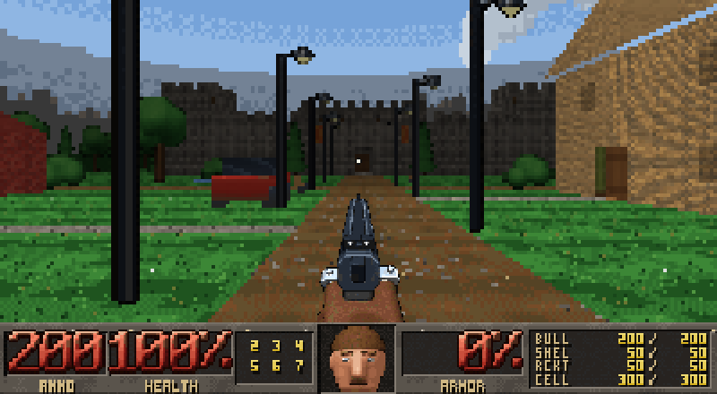
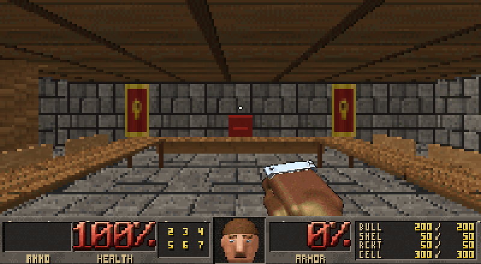
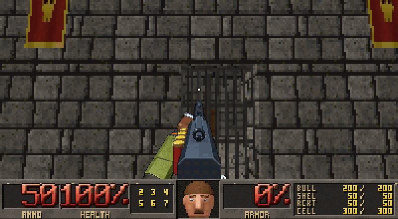
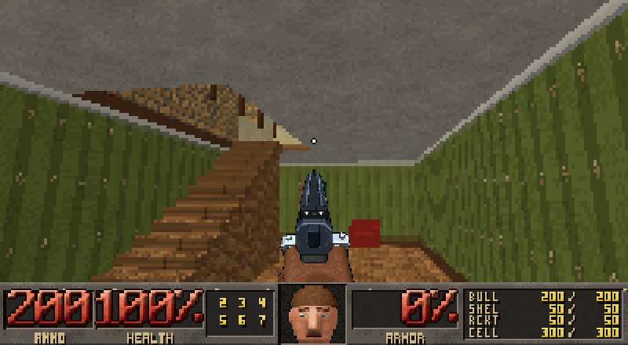
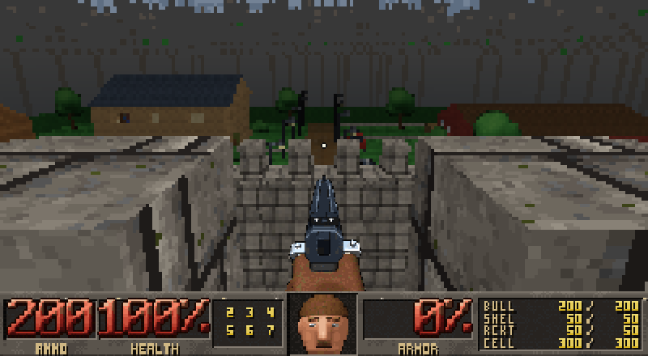
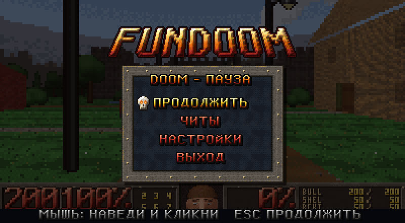

# FunDoom — 3D-шутер в консоли на C#

Шутер в духе DOOM, который рисуется прямо в окне терминала: каждая ячейка — два цветных
«пикселя» из полублоков `▀`. Внутри — собственный 3D-движок без сторонних библиотек:
программный растеризатор с буфером глубины, физика, двери, многоэтажные здания. Вся
графика и карта сгенерированы кодом.

| | |
| --- | --- |
|  |  |
|  |  |
|  |  |

## Возможности

- **Настоящий 3D в терминале.**
  - Перспективно-правильные текстуры, свет ступенями, как в Doom, небо-панорама.
  - Взгляд в любую сторону, вплоть до «прямо в пол» и «прямо в небо».
  - Никаких искажений у края кадра.
- **Движение.**
  - Прыжки на ящики и столы, ступени поднимаются сами.
  - Вертикальные лестницы, вторые этажи, балконы, ход по крепостной стене.
- **Двери и ворота** открываются на E; двустворчатые открываются вместе.
- **Восемь стволов** от кулака до BFG9000, у каждого своя анимация.
  - Пули и снаряды летят строго в прицел и взрываются там, куда попали: в пол, потолок или стену.
- **Карта «Городок у замка»:**
  - замок с четырьмя башнями, донжоном в три этажа и воротами-решёткой;
  - деревня из трёх домов с амбаром.
- **Графический HUD** с живым лицом героя и меню на собственном растровом шрифте (русский и английский).
- **Быстро даже в терминале.**
  - Разрешение 3D-вида настраивается отдельно от интерфейса.
  - В движении кадр упрощается (динамическое разрешение).
  - В терминал уходит только изменившаяся часть кадра.
- **Генераторы ресурсов в репозитории.**
  - Все текстуры, оружие, эффекты, HUD и шрифт рисует [tools/AssetForge](#графика-toolsassetforge).
  - Карту собирает [tools/MapForge](#карта-формат-assetsmapsmap).

## Быстрый старт

```powershell
git clone https://github.com/AlexZero5/Doom.git
cd Doom
dotnet run --project Doom/Doom.csproj -c Release
```

Лучше всего запускать в **Windows Terminal**: игра сама развернёт окно и уменьшит шрифт.
Управление: **WASD** и мышь, **ЛКМ** — огонь, **Space** — прыжок, **E** — дверь,
**1–7** — оружие, **Esc** — меню.

## Как это устроено

Каждая ячейка терминала — два квадратных «пикселя»: верхний и нижний (символ `▀` — цвет
символа сверху, цвет фона снизу). Трёхмерный вид рисуется во внутреннем кадре (настройка
«Разрешение») и растягивается на экран. Поверх в полном разрешении ложатся оружие, прицел
и строка состояния: патроны, здоровье, броня, слоты оружия, таблица боезапаса и лицо героя.

При выводе для каждой ячейки выбирается самый «дешёвый» глиф из равноценных: `▀`, `▄`, `█`
или пробел. Цвет меняется только там, где он отличается от текущего.

## Требования

- .NET SDK 10.0 (проект нацелен на `net10.0`)
- Windows — для удержания клавиш через `GetAsyncKeyState`, управления шрифтом консоли и
  «шторки» курсора. На других ОС игра работает, но удержание клавиш определяется по времени
  последнего нажатия.

## Сборка и запуск

```powershell
dotnet build Doom.sln
dotnet run --project Doom/Doom.csproj
```

Если `dotnet` не найден в PATH, используется SDK из профиля пользователя:

```powershell
& "$env:USERPROFILE\.dotnet\dotnet.exe" build Doom.sln
& "$env:USERPROFILE\.dotnet\dotnet.exe" run --project Doom/Doom.csproj
```

При старте показывается экран загрузки, во время которого игра «отдаляет» терминал до
максимума (самый мелкий шрифт — самые мелкие «пиксели»): уменьшает шрифт консоли напрямую,
а если это не дало эффекта (Windows Terminal) — нажимает «Ctrl + −» за пользователя.
Качество трёхмерной картинки задаёт уже не масштаб терминала, а настройка «Разрешение»
(см. ниже): строка состояния и меню всегда рисуются в полном разрешении и не мылятся.

## Управление

| Клавиша | Действие |
| --- | --- |
| W / S | шаг вперёд / назад; на вертикальной лестнице — вверх / вниз |
| A / D | шаг влево / вправо (стрейф) |
| Мышь | обзор: влево-вправо и вверх-вниз (до ±89° — можно смотреть прямо в пол и в небо) |
| ← / → | поворот |
| ЛКМ или F | выстрел (можно удерживать) |
| Space | прыжок (≈1.1 м: на ящик, стол, через забор) |
| E | использовать: открыть / закрыть дверь или ворота, на которые смотришь |
| 1 | кулак или бензопила (что найдено) |
| 2 … 7 | пистолет, дробовик, пулемёт, ракетница, плазменная винтовка, BFG9000 |
| Q | следующее найденное оружие |
| R | начать уровень заново |
| Esc | меню-пауза (продолжить / читы / настройки / выход) |

Ступени (до 0.42 м) игрок проходит сам, на уступы выше — запрыгивает. По вертикальной
лестнице лезут, стоя перед ней: W — вверх, S — вниз, наверху — шаг вперёд на площадку.
Выстрелы и снаряды летят строго в прицел — из глаз по направлению взгляда, с наклоном:
выстрел в пол попадает в пол.

Мышь работает как в шутере. Пока окно терминала на переднем плане, курсор удерживается на
месте (`CaptureMouse`) и прячется: под ним стоит невидимое окно-«шторка», поэтому курсор не
виден, а клики не выделяют текст терминала (настройка «Скрывать курсор»). При переключении
в другую программу курсор сразу возвращается.

## Меню, настройки и читы

Нажмите `Esc` во время игры — откроется меню-пауза поверх затемнённой сцены: логотип,
металлическая панель с заклёпками, мигающий череп-указатель, пункты своим растровым
шрифтом (русский и английский) с заливками, ползунки и галочки из картинок. Управление:
`↑`/`↓` — выбор, `←`/`→` — изменить, `Enter` — открыть/действие, `Esc` — назад или продолжить.

- **Продолжить** — вернуться в игру (настройки применяются сразу).
- **Читы** — «Дать всё» выдаёт весь арсенал и полный боезапас, у каждого ствола есть
  переключатель «ЕСТЬ/НЕТ», а у каждого типа патронов — ползунок запаса.
- **Настройки** — см. таблицу.
- **Выход** — завершить игру.

Настройки хранятся в `settings.json` рядом с игрой.

| Настройка | Тип | Что делает |
| --- | --- | --- |
| Разрешение | список: 100% … 25% | размер внутреннего кадра трёхмерного вида (показан в пикселях); меньше — грубее картинка и быстрее вывод, HUD и меню не меняются |
| Чувствительность мыши | ползунок | радианы поворота на каждый пиксель сдвига курсора |
| Скорость движения | ползунок | скорость ходьбы, м/с |
| Скорость поворота | ползунок | скорость поворота стрелками |
| Угол обзора | ползунок (50..120°, по умолчанию 90°) | горизонтальный угол обзора (FOV) |
| Захват мыши | переключатель | удерживать ли курсор во время игры |
| Скрывать курсор | переключатель | прятать курсор и не давать мыши выделять текст терминала |
| Прицел | переключатель | точка в центре экрана |
| Покачивание оружия | переключатель | покачивание ствола при ходьбе |
| Грубее в движении | переключатель | сильнее упрощать кадр, пока камера движется (см. «Производительность») |
| Счётчик FPS | переключатель | кадры, реально дошедшие до терминала |
| Авто-отдаление при старте | переключатель | уменьшать шрифт терминала при запуске |
| Разворачивать окно | переключатель | разворачивать окно терминала при запуске |

## Арсенал и боеприпасы

| Слот | Оружие | Боеприпасы | Особенности |
| --- | --- | --- | --- |
| 1 | Кулак | — | бронеперчатка, удары чередуются правой и левой |
| 1 | Бензопила | — | рукопашная, тарахтит на холостых, при ударе пилит |
| 2 | Пистолет | патроны | тяжёлый пистолет, затвор откатывается при выстреле |
| 3 | Дробовик | дробь | семь дробинок, после выстрела передёргивается цевьё |
| 4 | Пулемёт | патроны | очень частый огонь, блок из шести стволов вращается |
| 5 | Ракетница | ракеты | летящая ракета, взрыв с засветкой экрана |
| 6 | Плазменная винтовка | энергоячейки | пульсирующие плазменные шары |
| 7 | BFG9000 | энергоячейки | 40 ячеек за выстрел, реактор разгорается перед выстрелом |

Оружие спрятано по карте: дробовик — в доме у дороги, бензопила — на сеновале, плазма —
на втором этаже дома с балконом, пулемёт — в оружейной донжона, ракетница — на крыше
донжона, BFG — на крыше башни. Найденное оружие поднимается сразу (как в Doom).

## Структура решения

```
Doom/
├── Program.cs                         точка входа
├── Configuration/
│   ├── GameConfig.cs                  константы: игрок (рост, прыжок, ступени), оружие, тайминги
│   └── GameSettings.cs                настройки, хранятся в settings.json (с версией формата)
├── Core/
│   └── DoomGame.cs                    главный цикл: ввод → физика → выстрелы/двери → рендер → вывод
├── Platform/
│   ├── Ansi.cs                        escape-последовательности
│   ├── NativeMethods.cs               P/Invoke: шрифт консоли, клавиши, курсор, таймер, окна
│   ├── CursorShield.cs                невидимая «шторка» под курсором (прячет его и клики)
│   ├── ConsoleWindowLocator.cs        поиск и активация окна терминала
│   └── Terminal.cs                    запись в консоль, размер окна, масштаб, фокус, QuickEdit
├── Input/                             клавиатура, мышь, события консоли
├── Assets/                            PNG-загрузчик, бинарный кэш, текстуры с мип-уровнями, анимации
├── World/
│   ├── Geometry.cs                    Vec3, грань (Face), твёрдое тело (Solid)
│   ├── Level.cs                       уровень: грани, тела, двери, лестницы; столкновения и луч
│   ├── LevelBuilder.cs                клетки карты → грани и тела (склейка, «обои» комнат, перекрытия)
│   ├── MapLoader.cs                   чтение карты assets/maps/*.map (этажи, пролёты, двери)
│   ├── TextureMetrics.cs              мировой размер текстур (textures.txt)
│   ├── Door.cs                        двери и ворота; лестница, декорация, точка бонуса
│   ├── Prefabs.cs                     мебель, крыши, лестницы, перила, бочки, ящики…
│   ├── Quad3D.cs, Mesh3D.cs, MeshFactory.cs   заготовки мешей (бокс, крыша, цилиндр, рельеф)
│   └── Pickup.cs, PickupKind.cs       бонус на карте и его тип
├── Gameplay/
│   ├── Player.cs                      позиция и физика (гравитация, прыжок, ступени, лестницы), арсенал
│   ├── ProjectileSystem.cs            снаряды в 3D, взрывы, искры, засветка
│   └── …                              каталоги оружия, боеприпасов, бонусов, эффектов
├── UI/                                меню на растровом шрифте
└── Rendering/
    ├── Camera.cs                      камера: курс, наклон, фокус, лучи пикселей
    ├── Rasterizer.cs                  растеризатор треугольников: отсечение, глубина, текстуры, полосы-потоки
    ├── SceneRenderer.cs               кадр: куски уровня в поле зрения, спрайты, небо, растяжка, HUD
    ├── Lighting.cs                    ступенчатый свет (32 уровня, как COLORMAP)
    ├── MotionSimplifier.cs            режимы детализации в движении
    ├── WeaponRenderer.cs, HudRenderer.cs   оружие и строка состояния
    ├── ProjectilePalette.cs           размеры снарядов и эффектов
    ├── ConsolePresenter.cs            кадр → компактный ANSI-пакет (полный или дифф)
    └── FramePipeline.cs               отправка кадров отдельным потоком
tools/
├── AssetForge/                        генератор всей графики кодом
├── MapForge/                          генератор карты «Городок у замка»
└── ImgGen/                            генератор картинок нейросетью (прошлый инструмент, не используется)
```

```
assets/
├── textures/   материалы 64×64 + textures.txt (сколько метров занимает один повтор)
├── sky/        панорамы неба (day, dusk)
├── weapons/    кадры оружия: weapons/<ствол>/<кадр>.png
├── anims/      снаряды и взрывы: anims/<клип>/<кадр>.png + manifest.json
├── sprites/    бонусы и декорации + sprites.txt (пикселей на метр)
├── hud/        строка состояния, цифры, лица
├── ui/         шрифт, заливки, логотип, панель, череп, ползунки
└── maps/       town.map
```

## Карта: формат `assets/maps/*.map`

Мир — в метрах: клетка карты 1×1 м, этаж 3 м (2.8 м комнаты + 0.2 м перекрытия), глаза
игрока на 1.6 м. Карта — текстовый файл из секций (подробно — в `Doom/World/MapLoader.cs`):

```
[map]              name = … · sky = day · start = x y угол [этаж] · storey = 3
[walls]            B = brick_red                      стена на весь этаж
                   w = brick_red 0-0.9 2.1-3          пролёты в метрах: подоконник и перемычка = окно
                   M = castle_stone 0-1.2 keep        зубец; keep — не брать «обои» комнаты
                   E = door door_leaf brick_red 2.2   распашная дверь (E), над ней перемычка
                   G = gate gate_iron castle_stone 3  подъёмная решётка ворот
[floors]           p = parquet wallpaper_beige        пол и «обои» комнаты
[ceilings]         c = ceiling_plaster concrete       потолок и верх плиты, если этажа выше нет
[grid walls N]     сетка стен этажа N (0 — первый); «.» — пусто
[grid floors N]    сетка полов этажа N; нет пола — проём (лестница, люк, двор)
[grid ceilings N]  сетка потолков этажа N; нет — небо
[things N]         pickup <вид> x y [кол-во]
                   decor <спрайт> x y [solid радиус]
                   prop <предмет> x y [угол] [параметры]   z=… — высота над полом этажа
```

Пол этажа N и потолок этажа N−1 — одна плита перекрытия. Предметы: мебель (`sofa`, `bed`,
`table`, `wardrobe`, `bookshelf`, `fridge`…), `roof` (двускатная крыша), `stairs` (ступени,
подъём в сторону угла), `ladder` (вертикальная лестница), `rail` (перила), `crate`,
`barrel`, `hay`, `well`, `longtable`, `banner`, `platform`, `car`, `bench`. Соседние двери
одной буквы — двустворчатые и открываются вместе.

Карту «Городок у замка» собирает генератор (прямоугольники стен, этажей и проёмов кодом):

```powershell
dotnet run --project tools/MapForge -c Release   # перезаписывает assets/maps/town.map
```

## Графика: tools/AssetForge

Нейросеть здесь не используется: каждая картинка — код в `tools/AssetForge/Art/`.
Материалы — шум, кладка и узоры в общей палитре (16 рамп × 16 оттенков) с упорядоченным
дизерингом. Оружие, предметы и лица — маленький 3D-трассировщик SDF-фигур, затем то же
сведение к палитре. Прозрачность бинарная — без полупрозрачной «каймы» вокруг спрайтов.

```powershell
dotnet run --project tools/AssetForge -c Release                 # перегенерировать assets/
dotnet run --project tools/AssetForge -c Release -- --preview out # плюс листы предпросмотра
```

## Производительность

Рендер трёхмерного вида — 1–4 мс даже на 640×170 ячеек; узкое место — **терминал**: каждый
кадр — сотни килобайт escape-последовательностей. Поэтому:

- **Разрешение трёхмерного вида отдельно от терминала.** Терминал всегда отдалён до
  максимума, а сцена рисуется во внутреннем кадре меньшего размера (настройка
  «Разрешение») и растягивается. Когда внутренний кадр не выше числа строк терминала, обе
  половинки ячейки одного цвета — терминалу нужна одна смена цвета на ячейку.
- **Динамическое разрешение в движении.** Пока камера движется, кадр рисуется ещё в 1.35
  раза грубее и с цветом 5 бит на канал; галка «Грубее в движении» — вдвое грубее и 4 бита.
  Встали — следующий кадр полный. Оружие, прицел и HUD всегда чёткие.
- **Только видимое.** Уровень разбит на куски 8×8 м: куски вне пирамиды видимости
  отбрасываются целиком, грани, повёрнутые спиной, — до проекции, треугольники обрезаются
  ближней плоскостью; растеризация идёт полосами в несколько потоков.
- **Меньше уникальных цветов.** Свет ступенчатый (32 уровня), дальние поверхности берут
  мип-уровни текстур, текстуры — пиксель-арт с плоскими участками.
- Кадр уходит в терминал **отдельным потоком** (`FramePipeline`), в Windows Terminal — только
  изменившаяся часть кадра; точный таймер (`timeBeginPeriod(1)`); снаряды и эффекты — из пулов.

Замер на кадре 400×110 (поворот камеры во дворе замка, КиБ на кадр):

| Разрешение | Стоим | В движении | В движении, «Грубее» |
| --- | --- | --- | --- |
| 100% | 489 | 377 | 191 |
| 67% | 379 | 211 | 148 |
| 50% (по умолчанию) | 231 | 175 | 122 |
| 33% | 181 | 135 | 96 |

## Известные особенности

- Здоровье и броня пока только показываются в HUD: врагов нет, урона от падения тоже.
- Пули проходят сквозь решётку ворот (как сквозь прутья), но не сквозь двери.
- Без папки `assets/` игра всё равно запустится: запасная комната, серые «клетки» вместо
  текстур, текстовая строка состояния и встроенный шрифт меню.
- Разброс дробинок детерминирован (`SpreadNoise`), поэтому одинаковая серия выстрелов даёт
  одинаковую картинку — это упрощает автотесты.
- Подробности итераций — в [docs/](docs/): `code-review.md`, `iteration-2.md`, `iteration-3.md`.
